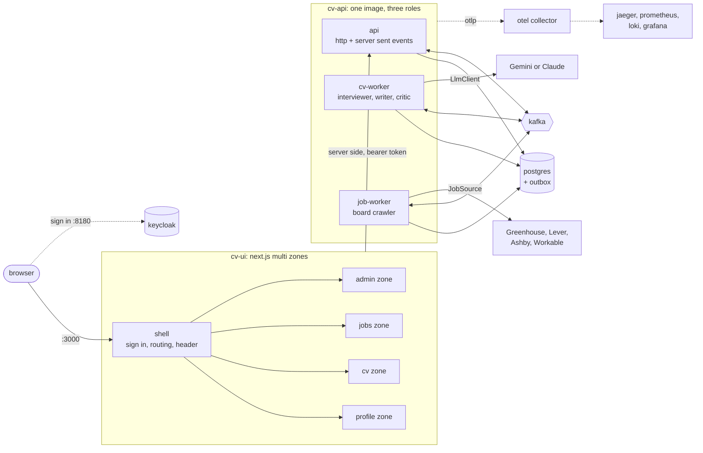

# Skill2Career

Takes a candidate's skills and experience, writes them a CV, and finds live jobs on companies' own job
boards that ask for their skills.

- **Profile:** the candidate's skills, experience, education and work history.
- **CV:** an interviewer asks about gaps in the profile, then a writer and a critic go round by round
  until the CV is good enough. A CV can be general, or aimed at one listed job.
- **Jobs:** the companies' own Greenhouse, Lever, Ashby and Workable boards are crawled daily. A
  candidate sees the jobs that ask for their skills, best first, filtered by remote only and location,
  and can ask why one fits them.
- **Admin:** the tracked companies and the health of each board's crawl.

## Structure

```text
cv-api/      Kotlin + Spring Boot, hexagonal: domain, application, adapters, app
             one image, run as the api, the cv-worker or the job-worker
cv-ui/       Next.js micro-frontends in a pnpm workspace
  apps/      the shell, and the profile, cv, jobs and admin zones
  packages/  shared: ui (design), auth, api-client
  e2e/       the Playwright journeys, and the WireMock stand-ins for Gemini and the job boards
charts/      helm charts
ci/          ci scripts and config: CVE scans, DORA, mutation testing
decisions/   why it is built the way it is: architecture, agents, jobs, messaging, ui, observability
local/       scripts and config for the local stack: seeding, crawling, deploys, grafana, prometheus
```

## Architecture



For the code itself, step by step, class by class, see [`docs/code-flow.md`](docs/code-flow.md).

### The ui

Next.js multi zones. The **shell** owns `localhost:3000`, signs the user in with Keycloak and routes each
zone's base path (`/profile`, `/cv`, `/jobs`, `/admin`) to that zone's own server. Each zone builds and
deploys on its own. The ui is a confidential client: tokens stay on the server in an encrypted session
cookie, never in the browser, and the zones' servers call the api with them. Every zone's header carries
the main navigation, as plain links, since moving between zones is a full page load. Admin is shown only
to the `ADMIN` role. See `decisions/ui.md`.

### The api

Kotlin and Spring Boot, hexagonal, with the gradle modules enforcing the direction:

| module | holds | depends on |
|---|---|---|
| `domain` | the model and its rules, pure kotlin | nothing |
| `application` | use cases, and the ports they need (`LlmClient`, `JobSource`, ...) | domain |
| `adapters` | web, jpa, kafka, the LLMs, the four job boards | application |
| `app` | the spring boot main, wiring, security, integration tests | all |

One image runs as one or more roles, set by `APP_ROLES`. Locally each is its own container:

| role | does | scales on |
|---|---|---|
| `api` | the http api, and the server sent event stream of a CV's progress | requests |
| `cv-worker` | the CV agents: the interviewer, then the writer and critic, up to 3 rounds | `cv.requested` lag |
| `job-worker` | crawls the job boards daily and keeps jobs fresh | `jobs.crawl` lag |

See `decisions/architecture.md`, `decisions/agents.md` and `decisions/jobs.md`.

### How a CV gets written

1. The cv zone posts the request. The api saves it, and its `cv.requested` event to the **outbox**, in one
   transaction, and returns `202 Accepted`.
2. A relay publishes the outbox to Kafka. The cv-worker takes one request at a time and calls the LLM.
3. The cv-worker publishes each step to `cv.progress`. Every api instance reads it and passes it to the
   browser's server sent event stream, so the page updates live: the interviewer's questions, each
   writer and critic round, then the finished CV.
4. If the LLM fails, the request is retried 4 times, 30s apart, then parked on `cv.requested.dlq`
   and marked failed, so the candidate is told to try again.

Every topic has a `.retry` and a `.dlq`, and every consumer is idempotent. See `decisions/messaging.md`.

### Underneath

- **Postgres 16**, with flyway the only owner of the schema.
- **Kafka**, in kraft mode, with a transactional outbox.
- **Keycloak**, one realm (`skill2career`) for the stack and the tests, with the test users built in.
- **OpenTelemetry**: traces to Jaeger, metrics to Prometheus, logs to Loki, all in Grafana. See
  `decisions/observability.md`.

## Run it

### What you need

- **Docker Desktop**, running. The whole stack runs in Docker Compose, about 17 containers, so it needs
  a good share of the machine's memory.
- **An LLM key.** Gemini is the default, and its key is free from
  [Google AI Studio](https://aistudio.google.com/app/apikey). The free tier may use what you send to
  improve Google's products, so use test profiles only. Or run without one, with the stand-in (below).
- To work on the code outside Docker: **JDK 25** for `cv-api`, and **Node 24** with **pnpm 12**
  (`corepack enable`) for `cv-ui`.

### Configure

Copy `.env.example` to `.env`. Git ignores it, so never commit a real key.

| setting | what |
|---|---|
| `LLM_PROVIDER` | `gemini` (the default) or `claude` |
| `LLM_MODEL` | blank for the provider's default (`gemini-flash-latest`, or `claude-opus-5-5`) |
| `GEMINI_API_KEY` | needed for `gemini`. The cv-worker does not start without it |
| `ANTHROPIC_API_KEY` | needed for `claude`, paid per token |

If the free `gemini-flash-latest` answers 503, high demand, set `LLM_MODEL=gemini-flash-lite-latest`.

### Start

```bash
docker compose up -d --build --wait
bash local/seed-profiles.sh   # a profile for each test user
bash local/crawl-now.sh       # crawl the job boards now, rather than wait for the daily crawl
```

The first build takes 5 to 10 minutes, as it compiles the api and builds the five Next.js apps. After
that, a start takes seconds. Then open http://localhost:3000 and sign in:

| user | password | can use |
|---|---|---|
| `candidate` | `test` | profile, CV, jobs |
| `candidate-other` | `test` | a second candidate, to check users can't see each other's data |
| `admin` | `test` | admin |

| what                         | where                                     |
|------------------------------|-------------------------------------------|
| the app                      | http://localhost:3000                     |
| api, swagger                 | http://localhost:8080/api/swagger-ui.html |
| keycloak admin               | http://localhost:8180 (admin / admin)     |
| kafka ui: topics, lag, dlq   | http://localhost:8090                     |
| grafana: metrics, logs       | http://localhost:3300                     |
| DORA dashboard               | http://localhost:3300/d/dora              |
| jaeger: traces               | http://localhost:16686                    |
| postgres                     | localhost:5432                            |

### Without an LLM key

`docker-compose.e2e.yml` points the cv-worker at WireMock playing Gemini. Every CV then gets the same
canned questions, drafts and review, but the whole flow works and costs nothing. To use only that stand-in
on the dev stack, put the cv-worker's part of it in a `docker-compose.*.local` file (git ignores those) and
add it with `-f`.

### Day to day

```bash
docker compose ps                                  # what is running, and healthy
docker compose logs -f cv-worker                   # follow one service's logs
docker compose up -d cv-worker                     # restart one service, eg after changing .env
docker compose up -d --build api cv-worker job-worker   # rebuild after changing cv-api
docker compose up -d --build shell profile cv jobs admin   # rebuild after changing cv-ui
docker compose up -d --scale cv-worker=3           # more cv-workers
docker compose down                                # stop, keeping the data
docker compose down --volumes                      # stop, and start empty next time
```

The database keeps its data in the `pgdata` volume across `docker compose down`.

### When it goes wrong

- **`failed to connect to the docker API`**: Docker Desktop isn't running. Start it and wait for
  `docker info` to answer.
- **A CV hangs, then fails with "Our writing service is busy"**: the LLM refused every try.
  `docker compose logs cv-worker` shows why, eg Gemini's 503, high demand. Try another `LLM_MODEL`, then
  start the CV again. A failed request is not replayed.
- **A build fails with `Exec format error` in a base image**: Docker's cached copy of that image is
  corrupt, usually from a cut off download. `docker rmi` the image, `docker builder prune -f`, and build
  again.
- **No jobs**: the job-worker crawls a minute after it starts, then daily. Run `local/crawl-now.sh`.

## DORA

The four DORA metrics, live, on grafana's DORA dashboard. Nothing deploys yet, so the local stack stands
in for production, as the environment `local`, and `local/deploy.sh` deploys to it: it builds the
commit's images, starts them, and records the deployment with each commit's lead time. Grafana's alerts on
the api's errors and latency count as change failures. In ci, a commit on main that passes every check is
recorded as a github deployment to `main`. See `decisions/dora.md`.

```bash
bash local/deploy.sh          # in place of docker compose up, to count as a deployment
```

## Test it

```bash
cd cv-api && ./gradlew check   # ktlint, unit and testcontainers tests, 90% coverage
cd cv-ui && pnpm check         # prettier, eslint, typecheck, jest
```

The Playwright journeys run against the whole stack, with WireMock standing in for Gemini and the job
boards. Run them on their own compose project, so they don't touch the dev stack's data:

```bash
docker compose -p cv-e2e -f docker-compose.yml -f docker-compose.e2e.yml up -d --build --wait shell cv-worker job-worker
cd cv-ui && pnpm e2e
```
