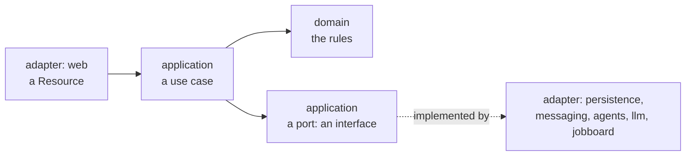
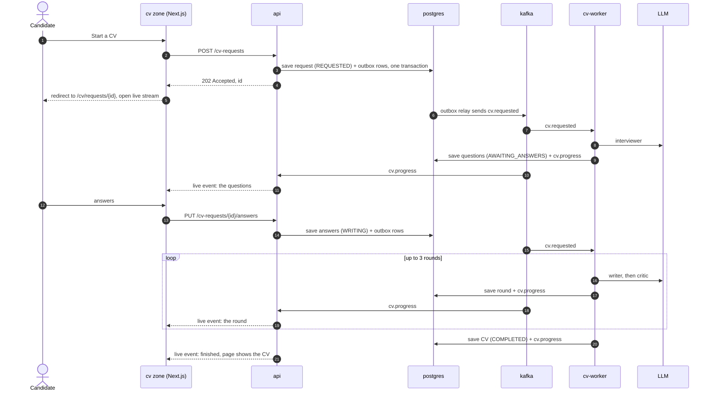
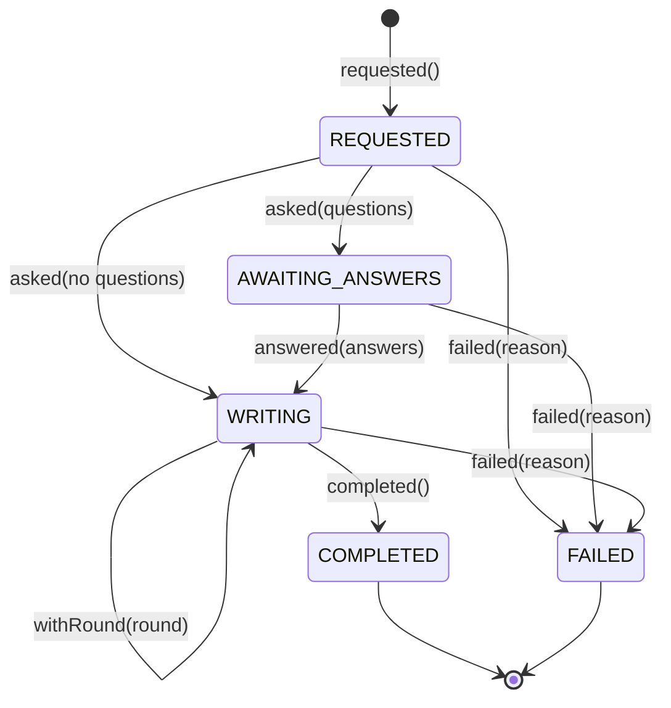
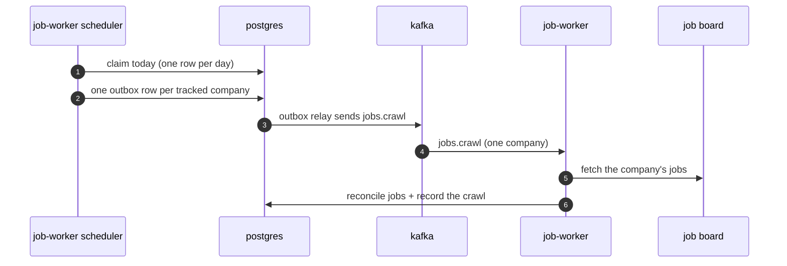

# How the code flows

A walk through the code, in the order it runs, for the two journeys that cross the whole system: a
candidate getting a CV, and the daily crawl of the job boards. Each step names the class and file that
does it. For why it is built this way, see `decisions/`.

## Reading the api

Every flow in `cv-api` goes through the same layers, from the outside in and back out:

- **Resource** (`adapters/.../adapter/web`): takes the http call, finds who is signed in, calls one use case.
- **Use case** (`application/...`): one class, one public function, eg `RequestCv.request`. It knows the
  steps, not the technology.
- **Domain** (`domain/...`): the rules, as plain Kotlin. Eg `CvRequest.answered` refuses answers to a
  request that isn't waiting for them.
- **Port** (`application/...`): an interface the use case needs, eg `CvRequestStore`, `Interviewer`,
  `JobSource`.
- **Adapter** (`adapters/...`): implements a port with real technology: JPA, Kafka, Gemini, Greenhouse.
- **Wiring** (`app/.../wiring`): joins them up. Each role (`api`, `cv-worker`, `job-worker`) has its own
  wiring class, so a role only builds what it uses.

So, to follow any feature: find its Resource or Kafka listener, then read the one use case it calls.

Paths below are shortened:

| short | full |
|---|---|
| `web/`, `messaging/`, `persistence/`, `agents/`, `llm/`, `jobboard/` | `cv-api/adapters/src/main/kotlin/com/skill2career/adapter/...` |
| `application/` | `cv-api/application/src/main/kotlin/com/skill2career/application/...` |
| `domain/` | `cv-api/domain/src/main/kotlin/com/skill2career/domain/...` |
| `wiring/` | `cv-api/app/src/main/kotlin/com/skill2career/app/wiring/...` |
| `cv-zone/` | `cv-ui/apps/cv/app/...` |

## A CV, from click to finished

### The whole journey

### The states

The whole journey is one `CvRequest` moving through five states. Every move is a function on it in
`domain/cv/CvRequest.kt`, and each refuses to run from the wrong state.

### Step by step

**1. The candidate starts a CV** (in the api process)

| step | where | what |
|---|---|---|
| form posts | `cv-zone/actions.ts` → `startCv` | a Next.js server action calls the api with the candidate's token, which stays on the server |
| http in | `web/cv/CvRequestResource.kt` → `request` | `POST /cv-requests`, the owner from the token |
| use case | `application/cv/CandidateUseCases.kt` → `RequestCv` | checks there is a profile (else 409) and the job, if any, is listed; makes a `CvRequest.requested` |
| save | `persistence/cv/CvRequestJpaAdapter.kt` → `save` | saves the request, and in **the same transaction** two outbox rows: work for `cv.requested`, and progress for `cv.progress` |
| reply | back in the Resource | `202 Accepted` with the id; the zone redirects to `/cv/requests/{id}` |

**2. The outbox reaches Kafka** (in every process)

| step | where | what |
|---|---|---|
| every 500ms | `wiring/CommonWiring.kt` → `OutboxSchedule` | runs the relay |
| send | `messaging/Outbox.kt` → `OutboxRelay.relay` | takes the oldest unsent rows (`FOR UPDATE SKIP LOCKED`, so two instances never send the same one), sends each to Kafka in order, marks it sent |

**3. The page follows along** (browser → cv zone → api)

| step | where | what |
|---|---|---|
| page | `cv-zone/requests/[id]/page.tsx` | loads the request and shows what its status needs: questions, progress or the CV |
| live | `cv-zone/CvProgress.tsx` | while `REQUESTED` or `WRITING`, opens an `EventSource` on the zone's own route |
| pass through | `cv-zone/requests/[id]/events/route.ts` | calls the api's stream with the token, so the token never reaches the browser |
| stream | `web/cv/CvRequestResource.kt` → `events`, `web/cv/ProgressStreams.kt` → `open` | sends the request as it is now, then keeps the stream open |
| on a change | `messaging/CvProgressListener.kt` → `ProgressStreams.changed` | every api instance reads every `cv.progress` (its own consumer group), and pushes the latest request to the streams it holds |
| reload | `cv-zone/CvProgress.tsx` | once the status needs the candidate or is final, closes the stream and refreshes the page |

**4. The interviewer asks** (in the cv-worker)

| step | where | what |
|---|---|---|
| message in | `messaging/CvWorkListener.kt` → `onWork` | reads `cv.requested`; skips an event id already in `processed_events` |
| use case | `application/cv/AgentUseCases.kt` → `AdvanceCvRequest.advance` | takes the request as far as it can go without the candidate |
| interview | → `InterviewCandidate.interview` | only if `REQUESTED`; asks the `Interviewer` port for up to 5 questions |
| agent | `agents/LlmAgents.kt` → `LlmInterviewer` | builds the prompt from the profile (`agents/Prompts.kt`), asks for json that fits a schema |
| one call | `agents/AgentCall.kt` → `ask` | calls the LLM; an unusable answer is asked for once more, then the agent fails |
| LLM | `llm/GeminiClient.kt` or `llm/ClaudeClient.kt` | the http call, chosen in `llm/LlmClients.kt` by `llm.provider` |
| save | `CvRequestJpaAdapter.save` | `AWAITING_ANSWERS` with the questions, plus a progress row, so the page shows them |

If the interviewer asks nothing, the request goes straight to `WRITING`, and `advance` carries on to step 6
in the same message.

**5. The candidate answers** (in the api)

| step | where | what |
|---|---|---|
| form posts | `cv-zone/actions.ts` → `answerQuestions` | checks lengths, then `PUT /cv-requests/{id}/answers` |
| use case | `application/cv/CandidateUseCases.kt` → `AnswerQuestions` | `CvRequest.answered` (a question left out is skipped); saves the answers to the **profile** as facts, so the next CV reuses them; saves the request as `WRITING` with work queued |

**6. The writer and critic** (in the cv-worker, a new `cv.requested` message)

| step | where | what |
|---|---|---|
| use case | `application/cv/AgentUseCases.kt` → `WriteCv.write` | only if `WRITING`; loops while `needsAnotherRound` |
| each round | same | `Writer.write(brief)`, then `Critic.review(brief, draft)`; saves the round, which sends progress |
| agents | `agents/LlmAgents.kt` → `LlmWriter`, `LlmCritic` | the writer follows `agents/CvGuide.kt` for the target role, and after round 1 the critic's feedback |
| rounds | `domain/cv/CvRequest.kt` → `needsAnotherRound` | stops when the critic approves, or after 3 rounds |
| finish | `CvRequest.completed` | the approved draft, else the best scoring one; `COMPLETED` |

Each round is saved as it finishes, so if the worker restarts mid-CV, the next try carries on from the last
saved round rather than starting again.

### When it goes wrong

| what | where | then |
|---|---|---|
| the LLM is down, rate limited or overloaded (`LlmUnavailable`) | `messaging/CvWorkListener.kt`, `@RetryableTopic` | the message is retried on `cv.requested.retry`, 30s apart, 4 tries in all |
| every try failed | `CvWorkListener.parked` → `application/cv/AgentUseCases.kt` → `GiveUpOnCvRequest` | the message is parked on `cv.requested.dlq`; the request is `FAILED`: "Our writing service is busy right now..." |
| the LLM answers, but unusably (`AgentFailure`) | `agents/AgentCall.kt`, then the use case | asked once more; then the request is `FAILED` at once, with the reason, as retrying won't help |
| the profile was deleted meanwhile | `InterviewCandidate`, `WriteCv` | `FAILED`: "The profile was deleted" |
| a message arrives twice | `CvWorkListener.onWork` | skipped by its event id; and each use case does nothing to a request already past its state |

## The daily crawl

| step | where | what |
|---|---|---|
| each hour | `wiring/JobWorkerWiring.kt` → `CrawlSchedule.check` | a minute after start, then hourly (`jobs.crawl.*` in `application.yml`) |
| claim | `messaging/JobCrawl.kt` → `CrawlScheduler.run`, `application/job/CrawlUseCases.kt` → `ScheduleCrawl` | the first job-worker to insert today's row in `crawl_runs` wins; it queues one crawl per tracked company, through the outbox (`OutboxCrawlQueue`) |
| message in | `messaging/JobCrawl.kt` → `JobCrawlListener.onCrawl` | one company per message, so crawls spread over the job-workers |
| use case | `application/job/CrawlUseCases.kt` → `CrawlCompany.crawl` | picks the `JobSource` for the company's board |
| board | `jobboard/GreenhouseSource.kt`, `LeverSource.kt`, `AshbySource.kt`, `WorkableSource.kt` | fetches the board's json, as `JobPosting`s |
| reconcile | `domain/job/Job.kt` → `Jobs.reconcile` | new jobs added, changed ones updated, ones gone from the board closed |
| record | `CrawlResults` | how it went, for the admin zone |
| failure | `JobCrawlListener` | recorded as failed, retried 3 times a minute apart, then parked on `jobs.crawl.dlq`; the company's jobs stay as they were until tomorrow |

`local/crawl-now.sh` and the admin zone's "crawl now" queue a crawl straight away, instead of waiting for
the daily one.

## Matching jobs

No Kafka here: the jobs zone asks, and the api answers from its own copy of the jobs.

| step | where | what |
|---|---|---|
| http in | `web/job/JobMatchResource.kt` → `GET /jobs/matches` | with the remote only and location filters |
| use case | `application/job/MatchJobs.kt` | reads the candidate's skills from their profile |
| search | `persistence/job/PostgresJobIndex.kt` | postgres full text search: the 200 best text matches for any of the skills |
| rank | `domain/job/Matching.kt` → `Matching.rank` | the domain's scoring of skills matched; the best 50 are shown |

"Why does this fit me?" works like a small CV request: `web/job/JobFitResource.kt` saves a fit summary and
queues it on `jobs.fit`, the cv-worker writes it in `messaging/FitWork.kt` with `agents/LlmFitExplainer.kt`,
and it is kept, so each job is explained once per candidate.

## Where to start reading

1. `domain/cv/CvRequest.kt`: the states and rules. Short, and everything else serves it.
2. `application/cv/CandidateUseCases.kt` and `application/cv/AgentUseCases.kt`: every step of a CV, in
   about 150 lines, with no framework code.
3. `messaging/CvWorkListener.kt` and `persistence/cv/CvRequestJpaAdapter.kt`: how those steps are driven
   by Kafka and saved with the outbox.
4. `wiring/CvWorkerWiring.kt`: how it is all joined up for one role.
