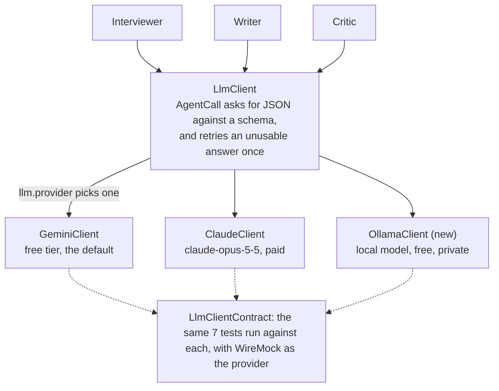

# Ticket: Ollama as a local LLM provider

Written 2026-11-22. Shared copy: https://claude.ai/artifact/J5eRuVXUj31DG3vQFbQPUm

## Summary

Add Ollama as a third LLM provider, so the CV agents (Interviewer, Writer, Critic) can run on a model on
our own machine: free, private, and with no rate limits. It is chosen by setting `llm.provider=ollama`; no
other code changes.

| Provider | Cost | Data leaves the machine | Limits | When to use |
| --- | --- | --- | --- | --- |
| Gemini free tier (current default) | Free | Yes; Google may use free-tier data to improve its products | Per-minute and per-day rate limits | Development with test profiles |
| Claude (`claude-opus-5-5`) | Paid per token | Yes, under Anthropic's API terms | Account rate limits | Best CV quality, real candidates |
| Ollama (this ticket) | Free | No | Speed of the host's hardware | Development, demos, and real data that must stay private |

## Where it fits



The agents only see the `LlmClient` interface, so Ollama is one new class plus its settings. The shared
contract tests prove it behaves like the other two.

## What to build

All in `cv-api/adapters/src/main/kotlin/com/skill2career/adapter/llm/`, test first, as the Gemini and
Claude clients were.

1. `OllamaClientTest : LlmClientContract()`: WireMock plays Ollama's `/api/chat`, and the 7 shared contract
   tests run against it (answer, request shape, refusal, cut short, 429, 503, unreachable).
2. `OllamaSettings(baseUrl = "http://localhost:11434", model, timeout)`. No API key.
3. `OllamaClient : LlmClient`, on Spring's `RestClient`, like `GeminiClient`.
4. Wiring: `llm.provider=ollama` picks it; `llm.model` names the model; `OLLAMA_URL` sets the address.
5. Docker: an `ollama` service in `docker-compose.yml` (image `ollama/ollama`, port 11434, a volume for
   downloaded models), behind a compose profile so it only starts when asked.
6. Docs: a line in `decisions/agents.md` naming the third provider, and README steps to pull a model.

## Technical notes

Ollama's chat API takes a JSON schema in its `format` field, so the agents' existing schemas work
unchanged. Written from memory: check each point against Ollama's API docs when the ticket starts.

The request, from an `LlmRequest`:

```json
{
  "model": "<llm.model>",
  "messages": [
    {"role": "system", "content": "<request.system>"},
    {"role": "user", "content": "<request.prompt>"}
  ],
  "format": {"type": "object", "...": "<request.schema>"},
  "stream": false
}
```

How each outcome maps onto the contract:

| Ollama response | Client result |
| --- | --- |
| 200, `done_reason: "stop"` | `message.content` is the answer |
| 200, `done_reason: "length"` | `LlmUnusableAnswer`: cut short |
| 200, empty `message.content` | `LlmUnusableAnswer` |
| 404 (model not pulled) | `LlmUnavailable`, with "run `ollama pull <model>`" in the message |
| 5xx, or connection refused or reset | `LlmUnavailable`, so Kafka retries later |

- A local model does not refuse the way Claude and Gemini do, so the contract's `refuses()` hook needs a
  stand-in: an empty answer.
- No API key and no auth header. Keep Ollama on the internal network only; it has no authentication of its
  own.

## Acceptance criteria

- [ ] `OllamaClientTest` passes all 7 shared contract tests, plus its own for `done_reason: "length"` and a
      model not pulled.
- [ ] `llm.provider=ollama` with `llm.model=<model>` runs a CV end to end: interview, answers, writer and
      critic rounds, finished CV.
- [ ] `docker compose --profile ollama up` starts Ollama, and the README says how to pull the model once.
- [ ] With Ollama stopped, a CV request is retried by Kafka, then parked in the dead-letter topic, never
      marked failed.
- [ ] `./gradlew check` passes, with the 90% coverage gate.
- [ ] `decisions/agents.md` names the third provider.

## Risks and open questions

- **CV quality.** A model small enough for a laptop writes weaker CVs and may miss invented facts as the
  Critic. Try two or three candidate models on the same test profiles, and compare against Gemini before
  choosing a default.
- **Hardware and speed.** Without a GPU, a CV (up to 7 calls) may take minutes. Set the client's timeout
  high, and raise the `cv-worker`'s Kafka `max.poll.interval.ms` above the slowest full CV, or Kafka
  reassigns the message mid-write.
- **Model download.** A model is several GB. Pull it once into the compose volume, never in an image build.
- **Open question:** one model for all three agents, or a stronger model only for the Critic? The current
  decision is one model throughout.
- **Open question:** should CI run the contract tests only (WireMock), never a real model? Recommended: yes,
  as for Gemini and Claude.
